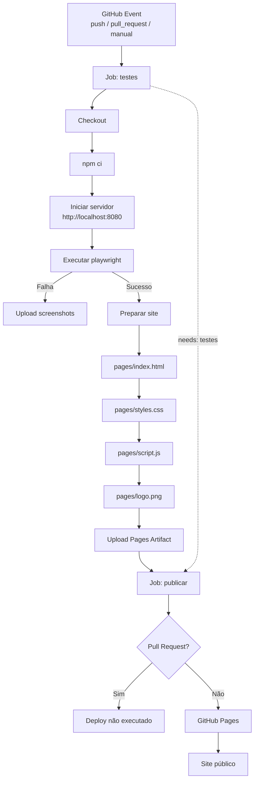

# Quiz Playwright

Desafia-se neste quiz que avalia seus conhecimentos em `PLAYWRIGHT`.


## O jogo

Um quiz simples com 20 perguntas de múltipla escolha. A cada resposta, o jogo mostra se você acertou ou errou, soma a pontuação e, ao final, exibe uma mensagem de acordo com o resultado.

## Tecnologias

- *HTML, CSS e JavaScript* - Contruindo a página
- *http-server* — servidor local simples, usado só para servir o jogo durante os testes
- *playwright* — framework de testes end-to-end
- *GitHub Actions* — roda os testes automaticamente a cada push


## Fluxo



## Estrutura do projeto

```bash
quiz-playwright/
├── game/ # Página HTML do QUIZ
│   ├── assets
│   │   ├── logo.png
│   │   ├── script.js
│   │   └── styles.css
│   └── index.html

├── .github/workflows/tests.yml # CI/CD
└── README.md # Documentação
```

## O que está sendo testado

| # | Caso de teste | Tipo |
|---|---|---|
| CT01 | Carregar o quiz deve exibir a primeira pergunta e 4 opções | Positivo |
| CT02 | Responder corretamente deve exibir mensagem de acerto | Positivo |
| CT03 | Responder incorretamente deve exibir a resposta certa | Negativo |
| CT04 | Concluir todas as 20 perguntas deve exibir a tela de resultado | Positivo |
| CT05 | Acertar todas as perguntas deve exibir mensagem de nota máxima | Positivo |
| CT06 | Errar todas as perguntas deve exibir mensagem de incentivo | Negativo |
| CT07 | Botão "Jogar novamente" deve reiniciar o quiz do zero | Positivo |

## Como rodar na sua máquina

Pré-requisito: [Node.js](https://nodejs.org) instalado.

```bash
# 1. Clonar o repositório
git clone git@github.com:horadoqa/quiz-playwright.git

# 2. Abrir o diretório
cd quiz-playwright/Playwright

# 3. Instalar as dependências
npm install

# 4. Instale os browsers:
npx playwright install

# 4. Rodar os testes (sobe o servidor e roda o playwright automaticamente)
npx playwright test

# 5. Resultado

[WebServer] (node:1852390) [DEP0066] DeprecationWarning: OutgoingMessage.prototype._headers is deprecated
[WebServer] (Use `node --trace-deprecation ...` to show where the warning was created)

Running 21 tests using 4 workers

  ✓   1 [chromium] › tests/quiz.spec.js:41:7 › Quiz de Playwright › CT02 - Responder corretamente deve exibir mensagem de acerto (1.8s)
  ✓   2 [chromium] › tests/quiz.spec.js:182:7 › Quiz de Playwright › CT04 - Concluir todas as 20 perguntas deve exibir a tela de resultado (11.6s)
  ✓   3 [chromium] › tests/quiz.spec.js:14:7 › Quiz de Playwright › CT01 - Carregar o quiz deve exibir a primeira pergunta e 4 opções (1.4s)
  ✓   4 [chromium] › tests/quiz.spec.js:101:7 › Quiz de Playwright › CT03 - Responder incorretamente deve exibir a resposta certa (1.4s)
  ✓   5 [chromium] › tests/quiz.spec.js:245:7 › Quiz de Playwright › CT05 - Acertar todas as perguntas deve exibir mensagem de nota máxima (11.6s)
  ✓   6 [chromium] › tests/quiz.spec.js:340:7 › Quiz de Playwright › CT06 - Errar todas as perguntas deve exibir mensagem de incentivo (11.2s)
  ✓   7 [chromium] › tests/quiz.spec.js:445:7 › Quiz de Playwright › CT07 - Botão "Jogar novamente" deve reiniciar o quiz do zero (10.4s)
  ✓   8 [firefox] › tests/quiz.spec.js:14:7 › Quiz de Playwright › CT01 - Carregar o quiz deve exibir a primeira pergunta e 4 opções (2.4s)
  ✓   9 [firefox] › tests/quiz.spec.js:41:7 › Quiz de Playwright › CT02 - Responder corretamente deve exibir mensagem de acerto (8.5s)
  ✓  10 [firefox] › tests/quiz.spec.js:101:7 › Quiz de Playwright › CT03 - Responder incorretamente deve exibir a resposta certa (8.0s)
  ✓  11 [firefox] › tests/quiz.spec.js:182:7 › Quiz de Playwright › CT04 - Concluir todas as 20 perguntas deve exibir a tela de resultado (16.9s)
  ✓  12 [firefox] › tests/quiz.spec.js:245:7 › Quiz de Playwright › CT05 - Acertar todas as perguntas deve exibir mensagem de nota máxima (12.1s)
  ✓  13 [firefox] › tests/quiz.spec.js:340:7 › Quiz de Playwright › CT06 - Errar todas as perguntas deve exibir mensagem de incentivo (13.5s)
  ✓  14 [firefox] › tests/quiz.spec.js:445:7 › Quiz de Playwright › CT07 - Botão "Jogar novamente" deve reiniciar o quiz do zero (12.6s)
  ✓  15 [webkit] › tests/quiz.spec.js:14:7 › Quiz de Playwright › CT01 - Carregar o quiz deve exibir a primeira pergunta e 4 opções (2.6s)
  ✓  16 [webkit] › tests/quiz.spec.js:41:7 › Quiz de Playwright › CT02 - Responder corretamente deve exibir mensagem de acerto (3.2s)
  ✓  17 [webkit] › tests/quiz.spec.js:101:7 › Quiz de Playwright › CT03 - Responder incorretamente deve exibir a resposta certa (3.1s)
  ✓  18 [webkit] › tests/quiz.spec.js:182:7 › Quiz de Playwright › CT04 - Concluir todas as 20 perguntas deve exibir a tela de resultado (19.6s)
  ✓  19 [webkit] › tests/quiz.spec.js:245:7 › Quiz de Playwright › CT05 - Acertar todas as perguntas deve exibir mensagem de nota máxima (19.5s)
  ✓  20 [webkit] › tests/quiz.spec.js:340:7 › Quiz de Playwright › CT06 - Errar todas as perguntas deve exibir mensagem de incentivo (18.8s)
  ✓  21 [webkit] › tests/quiz.spec.js:445:7 › Quiz de Playwright › CT07 - Botão "Jogar novamente" deve reiniciar o quiz do zero (18.5s)

  21 passed (1.2m)

To open last HTML report run:

  npx playwright show-report


```